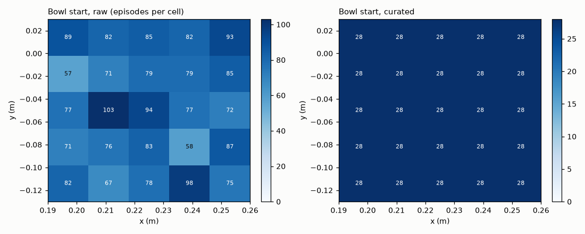
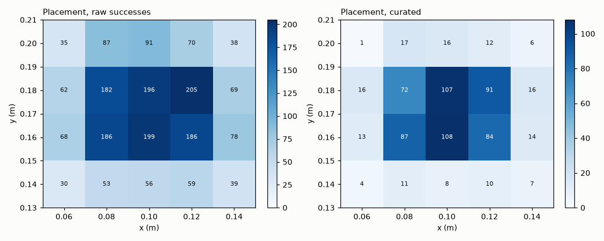
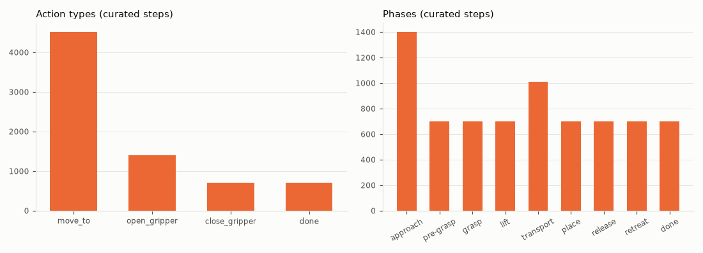
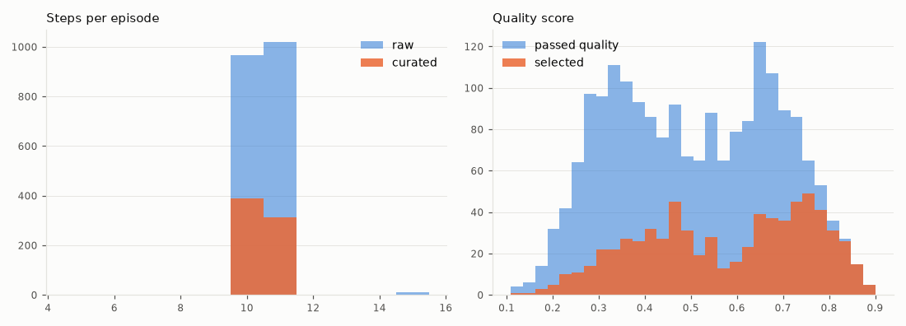
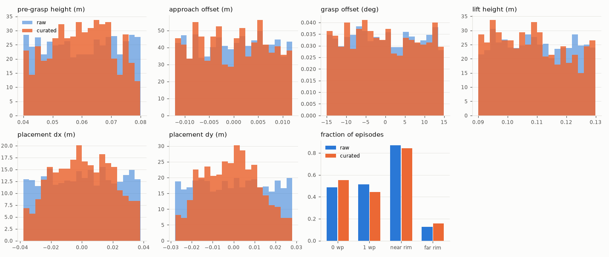

# Curation report

Raw sources: raw_episodes.jsonl. Raw data is never modified; this report is regenerated by `python -m data.curate`.

## Counts

| stage | episodes |
|---|---|
| raw (incl. top-up) | 2000 |
| passed quality filters | 1969 |
| near-duplicates removed | 0 |
| selected (stratified) | 700 |
| → train / val episodes | 630 / 70 |
| → train / val observation→action pairs | 6579 / 733 |

### Drop reasons (first failing filter per episode)

| reason | episodes |
|---|---|
| low_place_margin | 12 |
| not_success:failed_grasp | 10 |
| collision | 8 |
| not_success:step_limit | 1 |

Filters: final success; no rejected/unreachable actions; no collisions (robot–table/floor, or open gripper disturbing the bowl); no failed grasp attempts; steps ≤ p90 of successes in the same start cell; no redundant actions (move_to within 4 mm of the previous target, gripper toggling, repeated gripper command); placement margin ≥ 10 mm inside the target region.

## Quality score

`score = (w_steps·(1−norm(steps)) + w_path·(1−norm(ee_path)) + w_margin·norm(place_margin) + w_pre·(1−norm(|pregrasp_h − median|))) / Σw`, min-max normalized over passing episodes. Weights: `{"steps": 1.0, "path_length": 1.0, "place_margin": 1.0, "pregrasp_consistency": 0.5}`.

## Diversity / stratification

Bins = bowl start cell (5×5 over the spawn region) × 4 yaw bins = 100 bins; up to K=7 per bin. Within a bin, picks are greedy: least-represented variation values first (placement cell 2×2, waypoint count, approach side, grasp rim side), then score. Near-duplicates (start state + action trajectory within 4 mm) are dropped.

Top-up rounds run: 0 (episodes added: 0).

Thin bins (< 5 selected) after top-up: none.

Selected per bin: min 7, median 7, max 7.

## Step-level balance

| action type | steps | loss weight |
|---|---|---|
| move_to | 4512 | 1.0 |
| open_gripper | 1400 | 1.5 |
| close_gripper | 700 | 2.0 |
| done | 700 | 2.0 |

| phase | steps |
|---|---|
| approach | 1400 |
| pre-grasp | 700 |
| grasp | 700 |
| lift | 700 |
| transport | 1012 |
| place | 700 |
| release | 700 |
| retreat | 700 |
| done | 700 |

`close_gripper` and `done` occur once per episode; they are upweighted through per-example loss weights in training, not duplicated.

## Variation parameters

